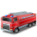

  
  <h1>RSiSed</h1>

**English** | [Русский](README_RU.md)

RSiSed is an application designed for the deployment of forces and resources in case of fire.

## Features
<!-- Add a short feature list here if desired -->

## Building

Build the project in Qt Creator. **Shadow build must be disabled** for all configurations.

## Contributing

We welcome contributions! Before opening an Issue or submitting a Pull Request, please read [CONTRIBUTING.md](CONTRIBUTING.md). It covers:

- How to choose the right template for Issues and PRs.
- Cross-platform verification requirements (Linux/Windows).
- Qt-specific guidelines: DPI-safe layouts, qmake → CMake migration, performance fixes.

## Bug Reports

Please report bugs via [GitHub Issues](https://github.com/ViktorAH14/rsised/issues).

## Pull Requests

Submit your changes via [GitHub Pull Requests](https://github.com/ViktorAH14/rsised/pulls).

## License

**RSiSed** is free software: you can redistribute it and/or modify
it under the terms of the GNU General Public License as published by
the Free Software Foundation, either version 3 of the License, or
(at your option) any later version.

**RSiSed** is distributed in the hope that it will be useful,
but WITHOUT ANY WARRANTY; without even the implied warranty of
MERCHANTABILITY or FITNESS FOR A PARTICULAR PURPOSE. See the
[GNU General Public License](https://www.gnu.org/licenses/gpl-3.0.html) for more details.

You should have received a copy of the GNU General Public License
along with this program. If not, see <https://www.gnu.org/licenses/>.