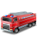

  
  <h1>RSiSed</h1>

[English](README.md) | **Русский**

RSiSed — приложение для расстановки сил и средств при пожаре.

## Возможности
<!-- При необходимости добавьте краткий список возможностей -->

## Сборка

Проект собирается в Qt Creator. **Теневую сборку (shadow build) необходимо отключить** для всех конфигураций.

## Участие в проекте

Рады вашему вкладу! Прежде чем заводить Issue или отправлять Pull Request, прочитайте [CONTRIBUTING.md](CONTRIBUTING.md). Там описано:

- Как выбрать подходящий шаблон для Issues и PR.
- Требования к кроссплатформенной проверке (Linux/Windows).
- Рекомендации по Qt: layout’и без жёстких пикселей, миграция с qmake на CMake, исправления производительности.

## Отчёты об ошибках

Об ошибках сообщайте через [GitHub Issues](https://github.com/ViktorAH14/rsised/issues).

## Pull Requests

Предлагайте изменения через [GitHub Pull Requests](https://github.com/ViktorAH14/rsised/pulls).

## Лицензия

**RSiSed** — свободное программное обеспечение: вы можете распространять его
и/или изменять на условиях Стандартной общественной лицензии GNU
(GNU General Public License), опубликованной Фондом свободного
программного обеспечения; либо версия 3 лицензии, либо (по вашему выбору)
любая более поздняя версия.

**RSiSed** распространяется в надежде, что он будет полезным,
но БЕЗ КАКИХ-ЛИБО ГАРАНТИЙ; даже без подразумеваемой гарантии
КОММЕРЧЕСКОЙ ПРИГОДНОСТИ или ПРИГОДНОСТИ ДЛЯ КОНКРЕТНОЙ ЦЕЛИ.
Подробнее см. в [Стандартной общественной лицензии GNU](https://www.gnu.org/licenses/gpl-3.0.ru.html).

Вместе с этой программой должна распространяться копия Стандартной
общественной лицензии GNU. Если её нет, см. <https://www.gnu.org/licenses/>.